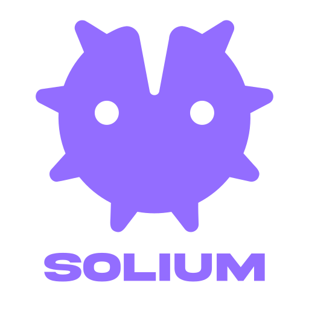
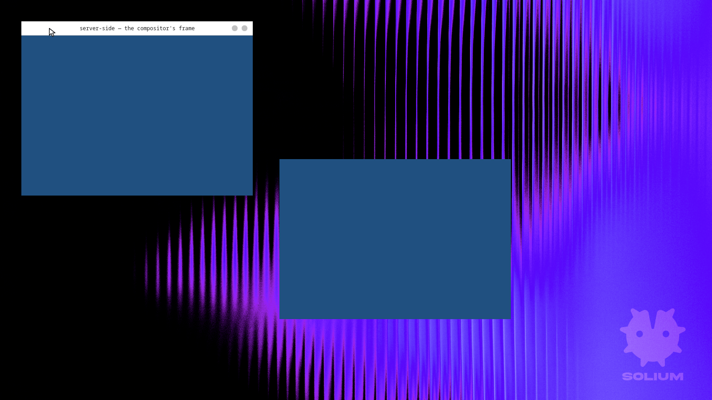

<p align="center">
  
</p>

# Solium

A standalone Wayland compositor written in Rust on
[Smithay](https://github.com/Smithay/smithay), with Lua configuration and QML
window frames and desktop scenes.

Solium combines floating, tiling, scrolling and overview modes with a shared
presentation and animation engine. Layout policy, desktop UI and effects are
files you can change without rebuilding the compositor.

[Documentation](https://lilium-linux.github.io/solium/) ·
[Known limitations](docs/gaps.md) · [Roadmap](docs/roadmap.md) ·
[Contributing](CONTRIBUTING.md) · [Discord](https://discord.gg/ATQNfHHvFa)

## Status

**Alpha.** Solium runs nested and on hardware, but is still being prepared for
reliable daily use. The planned v0.1.0 is a public preview; no release date is
promised. Check the [current status](docs/status.md) and
[preview criteria](docs/beta.md) before choosing it for your main session.

The shipped preview shell includes a bottom bar, an autohiding top dock,
application and window search, and desktop icons. It is configuration built
on Solium's public API, and can be replaced or disabled. A complete desktop
service stack, native lock UI and touch interaction with compositor UI are
still unfinished.



This capture predates the current dark theme and preview shell. It shows the
window-frame rendering, rather than the current desktop appearance.

## What it offers

| Area | Implemented |
|---|---|
| Window management | Floating, dwindle tiling, scrolling and overview; workspaces and layouts per monitor; XWayland clients |
| Presentation | Animated placement, opacity and mesh transforms; immediate launch, resize and close feedback |
| Appearance | QML window frames, wallpaper and hosted desktop scenes; reloadable Lua/QML; effects authored in Lua and GLSL |
| Displays | Multiple monitors, hotplug, per-output scale and refresh rate, configurable arrangement and screen power |
| Input | Keyboard layouts, bindings that work with non-Latin layouts, per-device libinput settings, cursor themes |
| Session integration | External lockers through session-lock, idle inhibition, logind lock/sleep integration, systemd and XDG autostart |

Implementation is not a guarantee that every application or device works.
Important gaps include input methods, clipboard managers, explicit sync,
multi-GPU output, compositor touch/gestures and end-to-end portal validation.
[Known limitations](docs/gaps.md) explains these and links to their issues.

## Building


Solium needs **Rust 1.88 or newer** (edition 2024), a C++17 compiler, **Qt 6.5
or newer** (Qt Quick and Qml), and the development files for Wayland,
libinput, libudev, libseat, xkbcommon, GBM, EGL and libdrm.
Lua is compiled in and needs nothing installed. The build also runs Qt's `moc`
on the headers of Solium's own QML types; `QT_MOC` names it when the build
cannot find it, and [dev/README.md](dev/README.md#building) says where it
looks.

Touch delivery uses QtBase's private event-point headers to preserve the press
history and grabs Qt Quick handlers need. Install the private development files
matching QtBase; a Qt minor-version upgrade requires rebuilding Solium.

Rust is easiest from [rustup](https://rustup.rs); a distribution's own Rust
works too if it is new enough. The system packages:

**Fedora**

```sh
sudo dnf install gcc gcc-c++ pkgconf-pkg-config wayland-devel libinput-devel \
    systemd-devel libseat-devel libxkbcommon-devel mesa-libgbm-devel \
    mesa-libEGL-devel libdrm-devel qt6-qtbase-devel qt6-qtbase-private-devel qt6-qtdeclarative-devel
```

**Arch Linux**

```sh
sudo pacman -S --needed base-devel wayland libinput systemd-libs seatd \
    libxkbcommon mesa libdrm qt6-base qt6-declarative
```

**Debian 13 and Ubuntu 24.10 or newer** (older releases ship a Qt older than
6.5)

```sh
sudo apt install build-essential pkg-config libwayland-dev libinput-dev \
    libudev-dev libseat-dev libxkbcommon-dev libgbm-dev libegl-dev libdrm-dev \
    qt6-base-dev qt6-base-private-dev qt6-declarative-dev
```

**openSUSE Tumbleweed**

```sh
sudo zypper install gcc-c++ pkgconf qt6-base-devel qt6-base-private-devel qt6-declarative-devel \
    'pkgconfig(wayland-server)' 'pkgconfig(libinput)' 'pkgconfig(libudev)' \
    'pkgconfig(libseat)' 'pkgconfig(xkbcommon)' 'pkgconfig(gbm)' 'pkgconfig(egl)' \
    'pkgconfig(libdrm)'
```

Then, from the checkout:

```sh
cargo build            # target/debug/solium; add --release for an optimised build
```

**Or in a container, on Fedora without the development packages.** The image
has the C toolchain and the libraries, and your own rustup install is mounted
into it. It is an image of Fedora, and what it builds links that release's
libraries, so build it for the release you run: `FEDORA_VERSION` (44 by
default) is a build argument of `dev/Containerfile`. On any other distribution,
install the packages above instead. A release whose Qt is older than 6.5 cannot
run Solium at all; a pull request from one still gets every check except the
GPU one from CI.

```sh
podman build -t solium-build:fc44 -f dev/Containerfile dev/
SOLIUM_GATE_IMAGE=localhost/solium-build:fc44 dev/gate.sh
```

In a clone, `dev/setup.sh` checks all of this for you, builds the image when
the packages are missing, and installs the project's git hooks.

`dev/gate.sh` builds and runs every check; [dev/README.md](dev/README.md#building)
has the plain `podman run` for a build on its own, and
[CONTRIBUTING.md](CONTRIBUTING.md) has the rest of what a change needs.

## Running it

Start nested inside an existing Wayland desktop first:

```sh
./target/debug/solium
```

For a hardware session, log into a free text console and run:

```sh
./target/debug/solium --probe   # inspect connectors and modes first
./target/debug/solium --tty
```

`--tty` takes control of the display; run it from a text console rather than
inside an existing desktop. After installation, use `solium` in place of the
path above.

| Command or default binding | Purpose |
|---|---|
| `solium --help` | Flags and environment variables |
| `solium --check` | Validate configuration and declared QML scenes; list bindings |
| `super+return` | Open a terminal |
| `super+d` | Open quick search |
| `super+shift+r` | Reload configuration |
| `super+shift+q` | End the session |

Bindings come from the shipped Lua configuration. See the generated
[key bindings](https://lilium-linux.github.io/solium/generated/reference/bindings.html)
for the full set. Hardware sessions log to
`${XDG_STATE_HOME:-~/.local/state}/solium/session.log`.

To leave a hardware session, use the quit binding or Ctrl+Alt+Backspace
(disabled while locked). Ctrl+Alt+F3 switches to a text console. These depend
on the compositor responding; see the
[recovery instructions](dev/README.md#running-it-on-a-tty-as-a-real-session)
before testing on hardware.

## Install

There are checkout-based installation tools and a Fedora 44 RPM build script.
There is no published package repository yet.

**Fedora 44 package:**

```sh
podman build -t solium-build:fc44 -f dev/Containerfile dev/  # once
dev/rpm.sh
sudo dnf install ./target/rpm/RPMS/x86_64/solium-0.0.0~git*.rpm
```

The script builds a development snapshot and needs `rpmbuild` on the host
(`sudo dnf install rpm-build`). The target machine needs the matching Fedora
release, not Rust or the build container.

**Local installation from a checkout**, using the Fedora build image:

```sh
dev/install.sh
sudo install -Dm644 ~/.local/share/solium/solium.desktop /usr/local/share/wayland-sessions/solium.desktop
```

The script installs into `~/.local`, validates the installed configuration and
prints the session-file command. Use `--prefix` for another location. Log out
and select Solium at the login screen. Choose either the RPM or the local
install to avoid duplicate session entries. The container must match your
system libraries; see [installation details](dev/README.md#installing-it)
for other build options, upgrades and removal.

The installed copy does not change when you rebuild the checkout. To remove a
local install, run `dev/install.sh --uninstall` and follow its printed command
for removing the session entry. Remove the RPM with `sudo dnf remove solium`.
Your configuration and logs remain.

The session wrapper starts graphical-session services and XDG autostart.
External programs provide services such as portals, authentication and locking;
configure a locker with `lock.command`. See
[session integration](docs/shell-boundary.md#how-the-rest-of-the-desktop-starts)
for setup and the legacy desktop identifiers currently used for compatibility.

## A first configuration

Create `~/.config/solium/user.lua` with just your changes:

```lua
return {
    pane = "left",
    -- preview = false,  -- disable the bundled preview shell
}
```

Run `solium --check`, then press `super+shift+r` in the session. The example
moves window titlebars to the left edge. A configuration that fails to load
leaves the running configuration in place and reports the error in the log.

Continue with [configuring Solium](docs/ricing.md), the
[settings reference](https://lilium-linux.github.io/solium/generated/reference/settings.html)
and the documented [defaults](crates/solium/lua/config.lua).

## How it is built

Rust owns protocols, input, window state and rendering primitives. Lua chooses
layouts, bindings and policy. QML supplies window frames and hosted desktop
scenes; effect folders combine Lua and GLSL. One compositor clock drives
window and QML animation.

The renderer uses Smithay's GLES renderer. Hardware sessions use DRM/libinput;
nested sessions use winit. QML uses the GPU on supported hardware after a
startup probe, with software rendering as a fallback and in nested sessions.
[Architecture](docs/architecture.md) explains the boundaries and tradeoffs.

Solium can host a shell in its QML engine or run ordinary layer-shell clients.
It does not require a particular desktop environment or a separate shell
project. The bundled preview is one configuration of the compositor.

## Find your way around

| Goal | Start here |
|---|---|
| Configure the desktop | [Configuration guide](docs/ricing.md), [modes](docs/modes.md), [decorations](docs/decorations.md) |
| Write a shell or effect | [Shell hosting and integration](docs/shell-boundary.md), [effects](crates/solium/effects/README.md) |
| Understand support and plans | [Status](docs/status.md), [known limitations](docs/gaps.md), [roadmap](docs/roadmap.md) |
| Develop Solium | [Contributing](CONTRIBUTING.md), [architecture](docs/architecture.md), [development tools](dev/README.md) |
| Report a problem | [Issue tracker](https://github.com/Lilium-Linux/solium/issues), [security policy](SECURITY.md) |

## License and credits

Solium is licensed under [GPL-3.0-only](LICENSE). See
[third-party notices](THIRD_PARTY.md) for dependency licenses and project
influences, and [CONTRIBUTING.md](CONTRIBUTING.md) for contribution terms.
