<p align="center">
  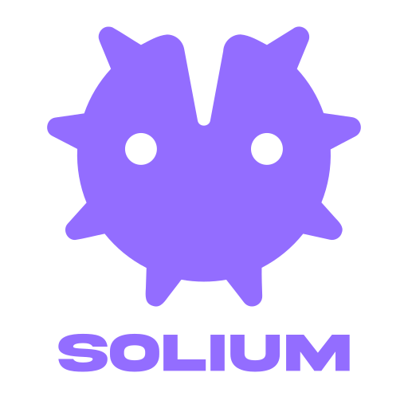
</p>

<p align="center">
  <a href="https://github.com/Lilium-Linux/solium/actions/workflows/ci.yml"></a>
  <a href="https://lilium-linux.github.io/solium/"></a>
  <a href="https://copr.fedorainfracloud.org/coprs/liliumlinux/solium/"></a>
  <a href="https://github.com/Lilium-Linux/solium/releases"></a>
  <a href="https://github.com/Lilium-Linux/solium/blob/stage/LICENSE"></a>
  <a href="https://github.com/Lilium-Linux/solium/blob/stage/rust-toolchain.toml"></a>
  <a href="https://discord.gg/ATQNfHHvFa"></a>
</p>

# Solium

A standalone Wayland compositor written in Rust on
[Smithay](https://github.com/Smithay/smithay), with Lua configuration and QML
window frames and desktop scenes.

Solium combines floating, tiling, scrolling and overview modes with a shared
presentation and animation engine. Layout policy, desktop UI and effects are
files you can change without rebuilding the compositor.

[Install on Fedora](#install) · [Documentation](https://lilium-linux.github.io/solium/) ·
[Showcase](docs/showcase.md) · [Known limitations](docs/gaps.md) · [Roadmap](docs/roadmap.md) ·
[Contributing](CONTRIBUTING.md) · [Discord](https://discord.gg/ATQNfHHvFa)

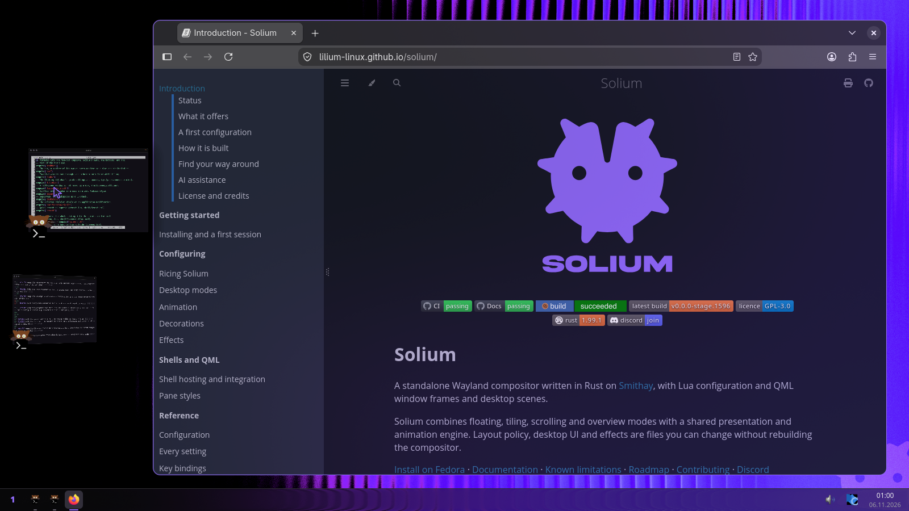

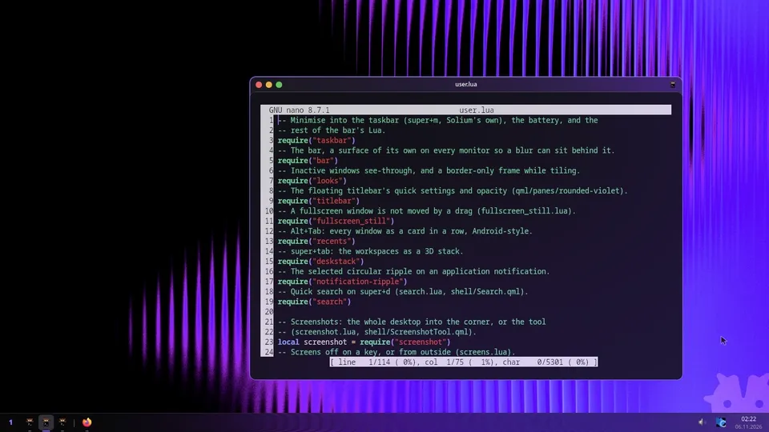

## Status

**Alpha.** Solium runs nested and on hardware, but is still being prepared for
reliable daily use. The planned v0.1.0 is a public preview; no release date is
promised. Check the [current status](docs/status.md) and
[preview criteria](docs/beta.md) before choosing it for your main session.

The default configuration is a whole desktop: a taskbar, a floating titlebar
with quick settings, window snapping, a stage-manager strip, quick search,
Alt+Tab cards and a 3D workspace stack. It is configuration built on Solium's
public API, copied into `~/.config/solium` on install, and yours to change. Solium has its own
lock screen, takes touch on its own UI as on windows, and serves notifications
and audio to scenes and Lua, follows media players and hosts the tray. Power,
network and Bluetooth services, gestures and input methods are still
unfinished.

<table>
<tr>
<td width="50%">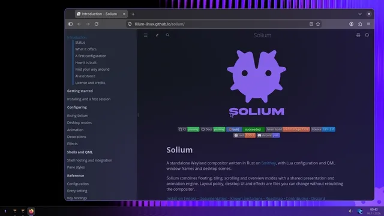<br><b>Atrium.</b> The window in use on the stage, every other application a live card at the edge.</td>
<td width="50%">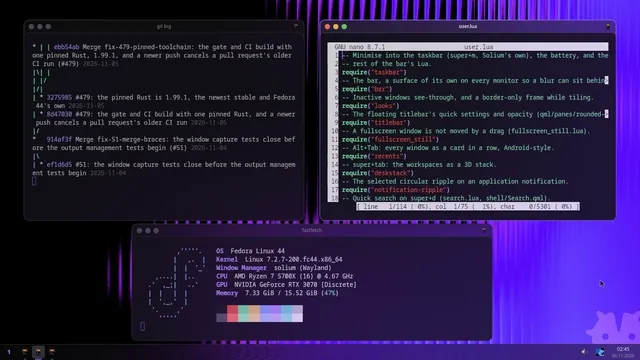<br><b>Tiling and back.</b> Titlebars fold into the border; floating again, every window glides home.</td>
</tr>
<tr>
<td>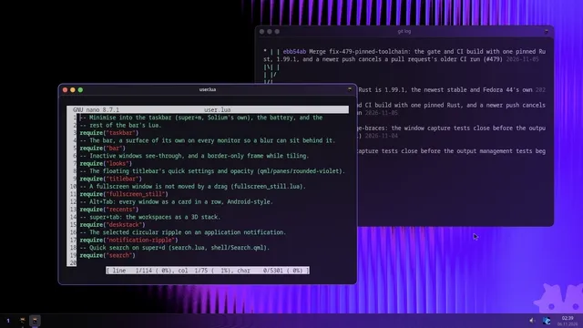<br><b>Into the taskbar.</b> The genie lands in the window's own button.</td>
<td>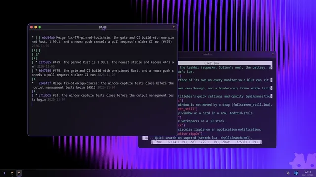<br><b>Snapping.</b> A preview at the edge, a glide on release.</td>
</tr>
<tr>
<td>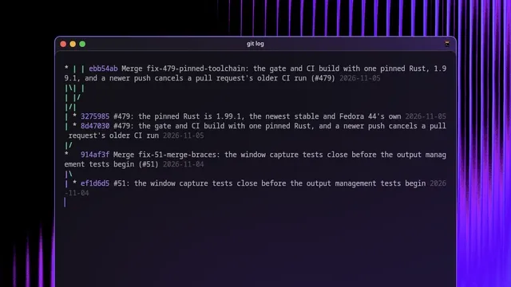<br><b>A titlebar that grows.</b> Quick settings for one window, in its own bar.</td>
<td>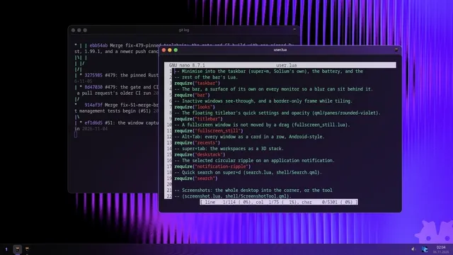<br><b>The lock.</b> The bar's clock flies to the middle and back.</td>
</tr>
</table>

Every one of these is a file of Lua or QML in the default configuration.
[The Showcase](docs/showcase.md) has more, each with how it is done.

## What it offers

| Area | Implemented |
|---|---|
| Window management | Floating, dwindle tiling, scrolling and overview; workspaces and layouts per monitor; XWayland clients |
| Presentation | Animated placement, opacity and mesh transforms; immediate launch, resize and close feedback |
| Appearance | QML window frames, wallpaper and hosted desktop scenes; reloadable Lua/QML; effects authored in Lua and GLSL |
| Displays | Multiple monitors, hotplug, per-output scale and refresh rate, configurable arrangement and screen power |
| Input | Keyboard layouts, bindings that work with non-Latin layouts, per-device libinput settings, cursor themes; touch on windows and compositor UI |
| Desktop services | The notification server, and PipeWire audio with per-application streams, for QML scenes and Lua |
| Session integration | Solium's own lock screen with an optional PIN, external lockers through session-lock, idle inhibition, logind lock/sleep integration, systemd and XDG autostart |

Implementation is not a guarantee that every application or device works.
Important gaps include input methods, clipboard privacy, multi-GPU output,
gestures and portals checked on hardware. Explicit DRM sync is available on
capable devices; Vulkan/NVIDIA hardware validation remains tracked in
[#59](https://github.com/Lilium-Linux/solium/issues/59).
[Known limitations](docs/gaps.md) explains these and links to their issues.

## Building


Solium needs **Rust 1.88 or newer** (edition 2024), a C++17 compiler, **Qt 6.5
or newer** (Qt Quick and Qml), the development files for Wayland,
libinput, libudev, libseat, xkbcommon, GBM, EGL, libdrm and PipeWire, libclang
(the PipeWire bindings are generated from its headers while building), and
PAM's runtime library, `libpam.so.0`, which every distribution installs by
default: the lock screen's password helper, `solium-auth`, declares the few PAM calls it makes
itself, so no PAM development package is needed.
Lua is compiled in and needs nothing installed. The build also runs Qt's `moc`
on the headers of Solium's own QML types; `QT_MOC` names it when the build
cannot find it, and [dev/README.md](dev/README.md#building) says where it
looks.

Touch delivery uses QtBase's private event-point headers to preserve the press
history and grabs Qt Quick handlers need. Install the private development files
matching QtBase; a Qt minor-version upgrade requires rebuilding Solium.

Rust is easiest from [rustup](https://rustup.rs); a distribution's own Rust
works too if it is new enough. The system packages:

**Fedora**

```sh
sudo dnf install gcc gcc-c++ pkgconf-pkg-config wayland-devel libinput-devel \
    systemd-devel libseat-devel libxkbcommon-devel mesa-libgbm-devel \
    mesa-libEGL-devel libdrm-devel qt6-qtbase-devel qt6-qtbase-private-devel qt6-qtdeclarative-devel \
    pipewire-devel clang-devel pam
```

**Arch Linux**

```sh
sudo pacman -S --needed base-devel wayland libinput systemd-libs seatd \
    libxkbcommon mesa libdrm qt6-base qt6-declarative pipewire clang pam
```

**Debian 13 and Ubuntu 24.10 or newer** (older releases ship a Qt older than
6.5)

```sh
sudo apt install build-essential pkg-config libwayland-dev libinput-dev \
    libudev-dev libseat-dev libxkbcommon-dev libgbm-dev libegl-dev libdrm-dev \
    qt6-base-dev qt6-base-private-dev qt6-declarative-dev libpipewire-0.3-dev \
    libclang-dev libpam0g
```

**openSUSE Tumbleweed**

```sh
sudo zypper install gcc-c++ pkgconf qt6-base-devel qt6-base-private-devel qt6-declarative-devel \
    'pkgconfig(wayland-server)' 'pkgconfig(libinput)' 'pkgconfig(libudev)' \
    'pkgconfig(libseat)' 'pkgconfig(xkbcommon)' 'pkgconfig(gbm)' 'pkgconfig(egl)' \
    'pkgconfig(libdrm)' 'pkgconfig(libpipewire-0.3)' clang-devel pam
```

Then, from the checkout:

```sh
cargo build            # target/debug/solium and solium-auth; add --release for an optimised build
```

**Or in a container, on Fedora without the development packages.** The image
has the C toolchain and the libraries, and your own rustup install is mounted
into it. It is an image of Fedora, and what it builds links that release's
libraries, so build it for the release you run: `FEDORA_VERSION` (44 by
default) is a build argument of `dev/Containerfile`. On any other distribution,
install the packages above instead. A release whose Qt is older than 6.5 cannot
run Solium at all; a pull request from one still gets every check except the
GPU one from CI.

```sh
podman build -t solium-build:fc44 -f dev/Containerfile dev/
SOLIUM_GATE_IMAGE=localhost/solium-build:fc44 dev/gate.sh
```

In a clone, `dev/setup.sh` checks all of this for you, builds the image when
the packages are missing, and installs the project's git hooks.

`dev/gate.sh` builds and runs every check; [dev/README.md](dev/README.md#building)
has the plain `podman run` for a build on its own, and
[CONTRIBUTING.md](CONTRIBUTING.md) has the rest of what a change needs.

## Running it

Start nested inside an existing Wayland desktop first:

```sh
./target/debug/solium
```

For a hardware session, log into a free text console and run:

```sh
./target/debug/solium --probe   # inspect connectors and modes first
./target/debug/solium --tty
```

`--tty` takes control of the display; run it from a text console rather than
inside an existing desktop. After installation, use `solium` in place of the
path above.

| Command or default binding | Purpose |
|---|---|
| `solium --help` | Flags and environment variables |
| `solium --check` | Validate configuration and declared QML scenes; list bindings |
| `super+return` | Open a terminal |
| `super+d` | Open quick search |
| `super+shift+r` | Reload configuration |
| `super+shift+q` | End the session |

Bindings come from the shipped Lua configuration. See the generated
[key bindings](https://lilium-linux.github.io/solium/generated/reference/bindings.html)
for the full set. Hardware sessions log to
`${XDG_STATE_HOME:-~/.local/state}/solium/session.log`.

To leave a hardware session, use the quit binding or Ctrl+Alt+Backspace
(disabled while locked). Ctrl+Alt+F3 switches to a text console. These depend
on the compositor responding; see the
[recovery instructions](dev/README.md#running-it-on-a-tty-as-a-real-session)
before testing on hardware.

## Install

**Fedora 44 and 45, from [COPR](https://copr.fedorainfracloud.org/coprs/liliumlinux/solium/)**,
with nothing to build:

```sh
sudo dnf copr enable liliumlinux/solium
sudo dnf install solium-stage
```

`solium-stage` is built from every push to `stage`, and `dnf upgrade` brings
each one after it. `solium` will hold the releases; the two conflict, so a
machine has one of them. Each stage build is also a
[prerelease on GitHub](https://github.com/Lilium-Linux/solium/releases) with its RPM for each Fedora release, for
`sudo dnf install ./<file>` without the repository. Log out and pick Solium at
the login screen. `sudo dnf remove solium-stage` takes it out again.

**A Fedora package from the checkout:**

```sh
podman build -t solium-build:fc44 -f dev/Containerfile dev/  # once
dev/rpm.sh
sudo dnf install ./target/rpm/RPMS/x86_64/solium-stage-*.rpm
```

The script builds a development snapshot and needs `rpmbuild` on the host
(`sudo dnf install rpm-build`). The target machine needs the matching Fedora
release, not Rust or the build container.

**Local installation from a checkout**, using the Fedora build image:

```sh
dev/install.sh
sudo install -Dm644 ~/.local/share/solium/solium.desktop /usr/local/share/wayland-sessions/solium.desktop
sudo install -Dm644 ~/.local/share/solium/solium.pam /etc/pam.d/solium
```

The script installs into `~/.local`, validates the installed configuration and
prints the session-file command, and the one that gives PAM the `solium`
service Solium's own lock screen checks a password against
(`solium --check` says whether it is there). Use `--prefix` for another location. Log out
and select Solium at the login screen. Choose either the RPM or the local
install to avoid duplicate session entries. The container must match your
system libraries; see [installation details](dev/README.md#installing-it)
for other build options, upgrades and removal.

The installed copy does not change when you rebuild the checkout. To remove a
local install, run `dev/install.sh --uninstall` and follow its printed command
for removing the session entry. Remove the package with
`sudo dnf remove solium-stage` (or `solium`).
Your configuration and logs remain.

The session wrapper starts graphical-session services and XDG autostart.
External programs provide services such as portals and authentication. Solium
locks the session with its own lock screen, checked through PAM by
`solium-auth`; `lock.command` runs an external locker instead. See
[session integration](docs/shell-boundary.md#how-the-rest-of-the-desktop-starts)
for setup and the legacy desktop identifiers currently used for compatibility.

## A first configuration

`dev/install.sh` puts Solium's default configuration in `~/.config/solium`
when you have none: a whole desktop written as configuration on the public API
(the bar and its tray, notifications and volume, a titlebar with quick
settings, Atrium, window snapping, Alt+Tab, screenshots, the lock screen, the
blur and the violet look). It is yours from then on: change any file, delete
what you do not want, or delete the folder to start from Solium's bare shipped
session. An install never writes over it; `share/solium/default-config` keeps
the original to compare with.

To start smaller, keep only `~/.config/solium/user.lua` with just your changes:

```lua
return {
    pane = "left",
}
```

Run `solium --check`, then press `super+shift+r` in the session, or just save:
the session reloads a configuration file that changes. The example moves
window titlebars to the left edge.

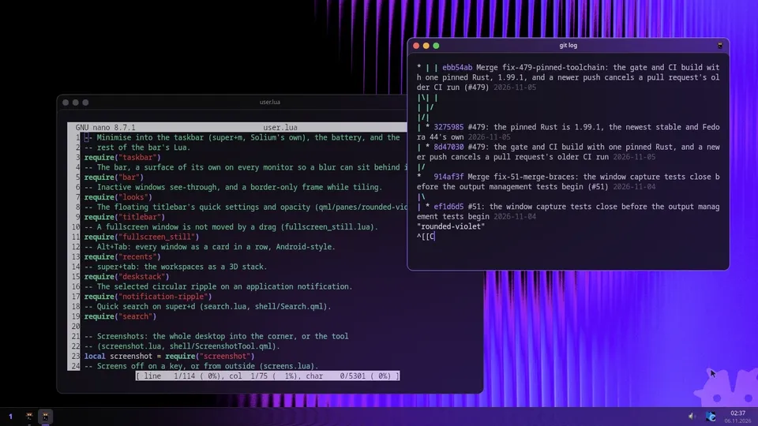
 A configuration that fails to load
leaves the running configuration in place and reports the error in the log.

Continue with [configuring Solium](docs/ricing.md), the
[settings reference](https://lilium-linux.github.io/solium/generated/reference/settings.html)
and the documented [defaults](crates/solium/lua/config.lua).

## How it is built

Rust owns protocols, input, window state and rendering primitives. Lua chooses
layouts, bindings and policy. QML supplies window frames and hosted desktop
scenes; effect folders combine Lua and GLSL. One compositor clock drives
window and QML animation.

The renderer uses Smithay's GLES renderer. Hardware sessions use DRM/libinput;
nested sessions use winit. QML uses the GPU on supported hardware after a
startup probe, with software rendering as a fallback and in nested sessions.
[Architecture](docs/architecture.md) explains the boundaries and tradeoffs.

Solium can host a shell in its QML engine or run ordinary layer-shell clients.
It does not require a particular desktop environment or a separate shell
project. The default configuration is one configuration of the compositor.

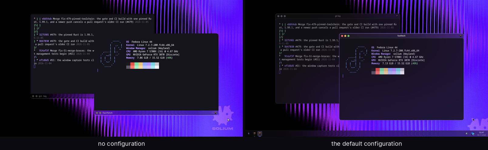

## Find your way around

| Goal | Start here |
|---|---|
| Configure the desktop | [Configuration guide](docs/ricing.md), [modes](docs/modes.md), [decorations](docs/decorations.md) |
| Write a shell or effect | [Shell hosting and integration](docs/shell-boundary.md), [effects](crates/solium/effects/README.md) |
| Understand support and plans | [Status](docs/status.md), [known limitations](docs/gaps.md), [roadmap](docs/roadmap.md) |
| Develop Solium | [Contributing](CONTRIBUTING.md), [architecture](docs/architecture.md), [development tools](dev/README.md) |
| Report a problem | [Issue tracker](https://github.com/Lilium-Linux/solium/issues), [security policy](SECURITY.md) |

## AI assistance

Solium is actively developed with AI assistance: AI coding agents generate
code, review changes and help manage tasks and the issue board. The maintainer
decides what lands. Every change starts from an issue, passes the project's
checks, and is reviewed and merged by the maintainer. Commits and pull
requests carry no AI attribution, so this section is the project's disclosure.

## License and credits

Solium is licensed under [GPL-3.0-only](LICENSE). See
[third-party notices](THIRD_PARTY.md) for dependency licenses and project
influences, and [CONTRIBUTING.md](CONTRIBUTING.md) for contribution terms.
