<!-- Written by dev/showcase/record.py --page from dev/showcase/page.toml
     and the shots in dev/showcase/shots/: change those, not this. -->

# Showcase

Everything on this page was recorded from Solium itself, nested, on the
configuration that ships, and is made again by one command,
`dev/showcase/record.py`, whenever the desktop changes. Nothing is drawn on a
frame afterwards. Under each one is how it is done: almost always a file of
Lua or QML in the default configuration, which is yours to change.

## The desktop as it ships

### The desktop as it ships

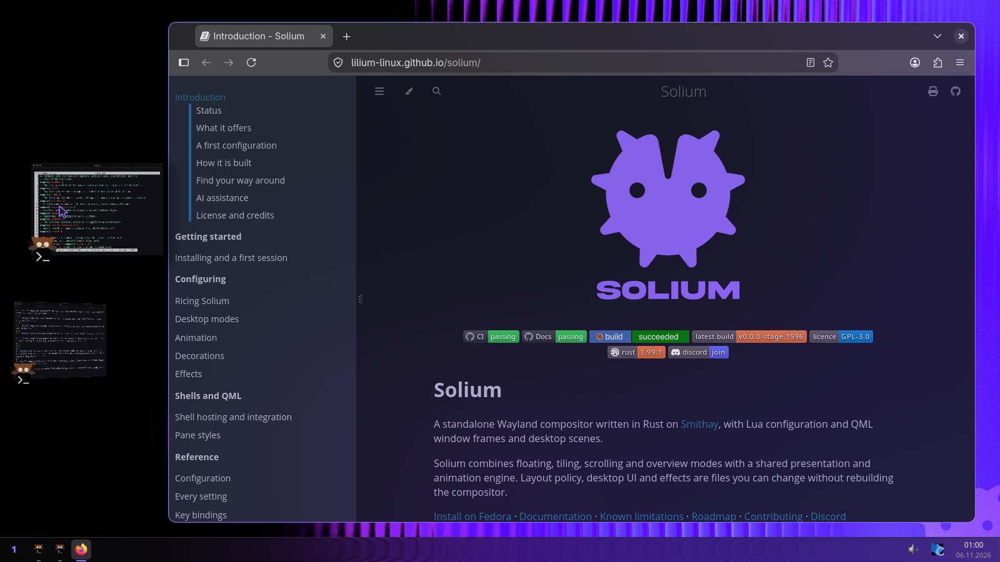

The default configuration as it is installed: the bar, rounded violet frames over a frosted backdrop, and Atrium's strip of live cards, brought out by the pointer at the left edge.

**How it is done.** The whole desktop is the default configuration, a folder of Lua and QML copied into ~/.config/solium on install. Its user.lua starts by requiring each piece of it; delete a line and that piece is gone.

[`crates/solium/default-config/user.lua`](../crates/solium/default-config/user.lua)

```lua
-- Minimise into the taskbar (super+m, Solium's own), the battery, and the
-- rest of the bar's Lua.
require("taskbar")
-- The bar, a surface of its own on every monitor so a blur can sit behind it.
require("bar")
-- Inactive windows see-through, and a border-only frame while tiling.
require("looks")
-- The floating titlebar's quick settings and opacity (qml/panes/rounded-violet).
require("titlebar")
-- A fullscreen window is not moved by a drag (fullscreen_still.lua).
require("fullscreen_still")
-- Alt+Tab: every window as a card in a row, Android-style.
require("recents")
-- super+tab: the workspaces as a 3D stack.
require("deskstack")
-- The selected circular ripple on an application notification.
require("notification-ripple")
-- Quick search on super+d (search.lua, shell/Search.qml).
require("search")
```

### Alt+Tab and the workspace stack

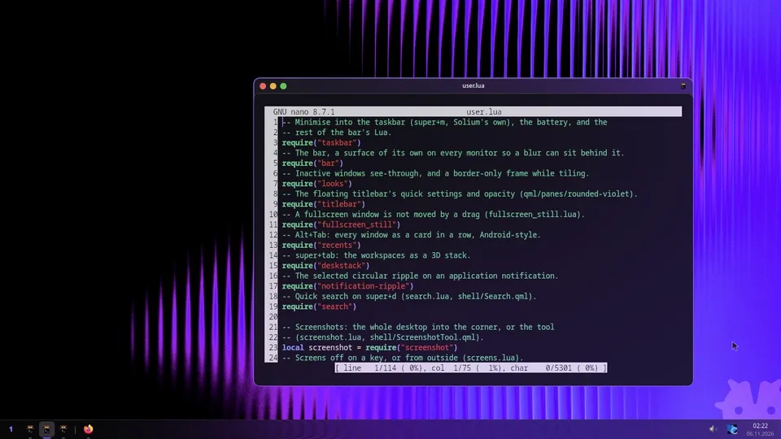

Alt+Tab lays every window out as a live card; super+tab stands the workspaces up as a 3D stack and the wallpaper pans to the one chosen.

**Keys:** alt+tab, return · super+tab, down, return

**How it is done.** Both are files of the default configuration. recents.lua presents every live window where a row puts it, with sol.present: the cards are the windows themselves, never screenshots. deskstack.lua turns each workspace into a plane of its windows and tilts it about the desk's centre.

[`crates/solium/default-config/recents.lua`](../crates/solium/default-config/recents.lua)

```lua
-- Alt+Tab as Android's recents: every window as a card in one row across the
-- screen, most recently used first, the chosen one big in the middle.
--
--   alt+tab / alt+shift+tab   open on the previous window, then step
--   tab, arrows, the wheel    step, once Alt is let go
--   (the pointer is held by the shell's picker layer meanwhile: Shell.qml)
--   enter, space, a click     switch to the chosen window
--   escape, a click outside   close, leaving everything as it was
--
-- Picking is a key or a click, not letting go of Alt: a script is told about
-- key presses, not releases.
--
-- The cards are the live windows themselves, presented where the row puts
```

[`crates/solium/default-config/deskstack.lua`](../crates/solium/default-config/deskstack.lua)

```lua
-- A 3D overview of the workspaces: they stand in a vertical stack, the chosen
-- one flat and large in the middle on its plate, the ones above and below it
-- tilted away from you, smaller and dimmer, the way the workspaces slide.
--
--   super+tab                 open, then the next desk (wrapping)
--   super+shift+tab           open, then the one before
--   up/down, k/j, tab, wheel  choose
--   1..9                      go straight to that workspace
--   enter, space, a click     go there (a click on a window picks its desk)
--   escape                    close, staying where you were
--
-- Each workspace is a plane made of its windows: every window of a desk is
```

### Atrium

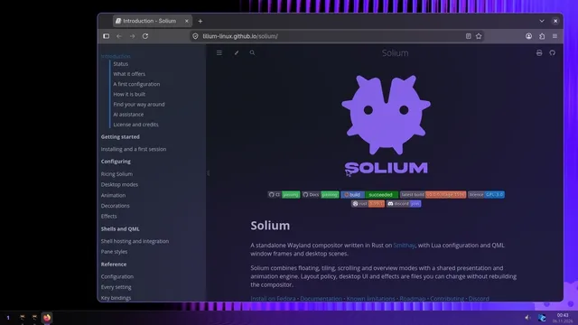

Stage Manager on the floating desktop: the window in use on the stage, every other application a live, tilted card in a strip that slides in at the left edge. A click brings a card's group onto the stage.

**Keys:** the pointer at the left edge, a click on a card

**How it is done.** Atrium is part of floating mode, crates/solium/lua/atrium.lua, and placing nothing: the cards are sol.presents of the live windows in perspective, and a click is only a change of focus. The default configuration turns it on in user.lua, with its key.

[`crates/solium/default-config/user.lua`](../crates/solium/default-config/user.lua)

```lua
    floating = {
        atrium = { enabled = true, key = "super+a" },
    },
```

### Floating and tiling

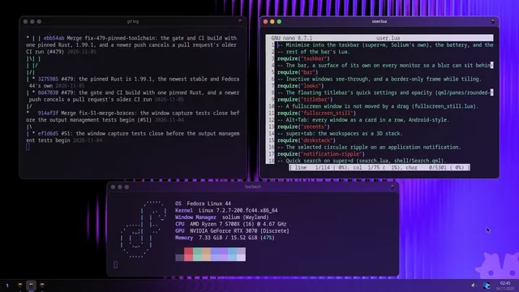

[4 times slower](media/tiling-x4.mp4)

super+t tiles the desktop and every titlebar folds into its window's border; super+t again and each window glides back to where it was.

**Keys:** super+t, super+t

**How it is done.** The titlebar is the rounded-violet frame, which folds its bar into the border as the window goes into a tile (one QML frame for both, nothing rebuilt). Coming back to floating, looks.lua glides every window to where it was.

[`crates/solium/default-config/looks.lua`](../crates/solium/default-config/looks.lua)

```lua
--   * switching from floating to a tiling layout remembers where every
--     window was, and switching back glides each one there again, so a
--     desktop arranged by hand comes back as it was;
```

### Minimise into the taskbar

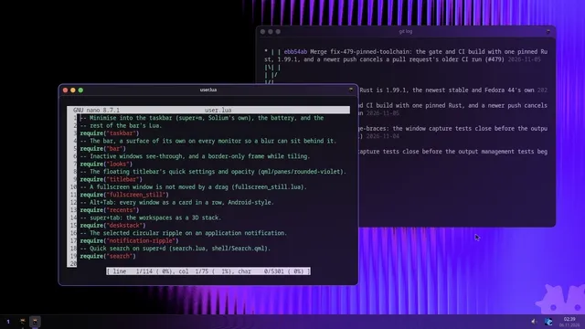

[4 times slower](media/minimize-x4.mp4)

super+m pulls the window into its own taskbar button with the genie; a click on the button plays it back out.

**Keys:** super+m, a click on the button

**How it is done.** The default configuration's taskbar.lua points the minimise at the window's own button: a present of the window, deformed by the effect folder named genie, a page of Lua that places a grid of points for each moment.

[`crates/solium/default-config/taskbar.lua`](../crates/solium/default-config/taskbar.lua)

```lua
-- Draw window `id` squeezed into its button. What the shipped `minimize`
-- event plays, once `aim` has pointed it here; also used by the window
-- switcher (recents.lua) to put one back after showing it as a card.
function taskbar.park(id)
    local config = require("config")
    sol.animate(config.minimize.motion)
    sol.present(id, {
        deform = {
            effect = "genie",
            axis = "down",
            spread = config.minimize.spread,
            to = target(id),
        },
    })
end
```

### Snapping

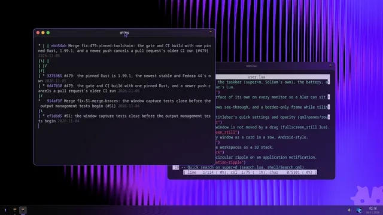

A window dragged to the right edge shows where it will go, and glides there when let go; dragged away, it comes back to its own size under the pointer.

**Keys:** drag a titlebar to the right edge, and back

**How it is done.** crates/solium/lua/snap.lua, in Lua: the drag events say where the pointer is, a scene draws the preview, and sol.place glides the window into the zone. The left edge is Atrium's here, so this one snaps to the right.

[`crates/solium/lua/snap.lua`](../crates/solium/lua/snap.lua)

```lua
-- Snapping a floating window by dragging it to a screen's edge (#455), as
-- Windows, macOS and KDE do, and the holder between windows snapped side by
-- side.
--
-- While floating is in charge (`modes.lua`), a window dragged by its titlebar,
-- with the drag modifier, or by a finger:
--
--   * shows a preview of where it would go while the pointer is in a zone of
--     the screen it is on: the left or right edge is that half of the work
--     area, a corner that quarter, the top edge the whole work area
--     (`floating.snap.drag.top`), bottom corners their quarter;
--   * let go in a zone, glides there with `tiling.snap`'s motion, the one a
--     tiled window snaps into its tile with, and is marked as snapped:
--     `sol.frame(id, { snapped = <zone> })`, so a pane style can square its
```

### The extendable titlebar

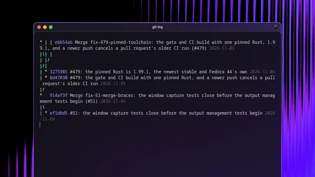

A right click on the titlebar grows it, and the window's content moves down to make room: quick settings for that one window. Esc folds it away.

**Keys:** a right click on the titlebar, Esc

**How it is done.** QuickSettings.qml, part of the rounded-violet frame. The bar asks the compositor for room with growTop, so the window's content moves down instead of being covered, and titlebar.lua answers what its buttons ask.

[`crates/solium/default-config/qml/panes/rounded-violet/QuickSettings.qml`](../crates/solium/default-config/qml/panes/rounded-violet/QuickSettings.qml)

```qml
// The window's quick settings, inside the titlebar: a right click on the bar
// grows the bar (Frame.qml asks the compositor for the room with `growTop`,
// so the window's content moves down rather than being covered) and these
// show in the new part of it. Esc or a press anywhere else folds it away.
//
// Frame.qml places it, tells it about the window, and holds the `Grab` that
// keeps the pointer and the keys here while it is open.
```

### The lock screen

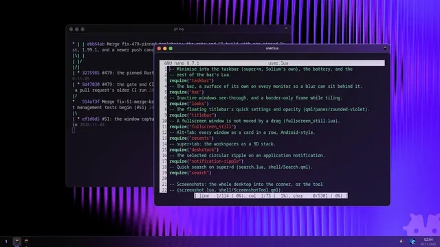

[4 times slower](media/lock-x4.mp4)

super+ctrl+l: the clock flies from the bar to the middle as the session locks, and back into the bar as it unlocks.

**Keys:** super+ctrl+l

**How it is done.** The lock is a QML scene, Violet.qml in the default configuration, named in user.lua. Solium draws the desktop under it while it comes and goes, for enter_ms and exit_ms, and never shows it the password.

[`crates/solium/default-config/user.lua`](../crates/solium/default-config/user.lua)

```lua
    lock = { scene = "Violet", enter_ms = 600, exit_ms = 700 },
```

## Make it yours

The default configuration is an example, copied into `~/.config/solium` on
install. Change a file and the running session reloads it.

### Your configuration, live

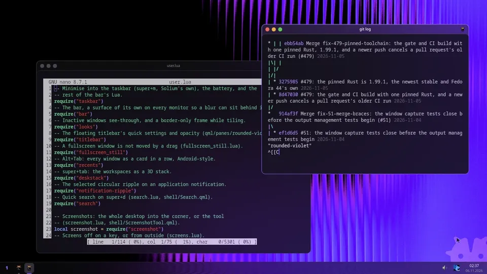

The frame style is one line of user.lua. Changed and saved, the running session reloads it: every window is reframed on the spot, and back again.

**Keys:** editing user.lua in nano: pane = "left", save

**How it is done.** The frame style is pane in user.lua. Solium watches the configuration's files and reloads it when one is saved: the panes are rebuilt and every window keeps its place.

[`crates/solium/default-config/user.lua`](../crates/solium/default-config/user.lua)

```lua
    pane = "rounded-violet",
```

### The desktop is configuration

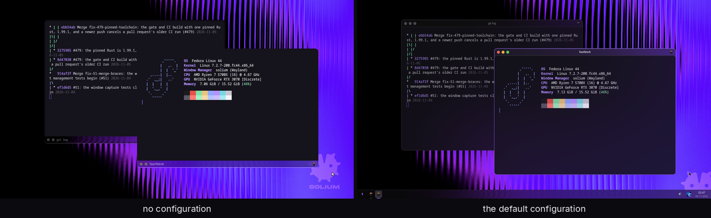

One compositor, two configurations: nothing in ~/.config/solium, and the default one install puts there.

## Lock screens

A lock screen is a QML scene, chosen by `lock.scene`. Solium draws the
desktop under it while it comes in and goes out, ends each at its bound, and
never shows it the password: the scene only has to look right at every moment
of its own entry and exit.

### Four ways to lock

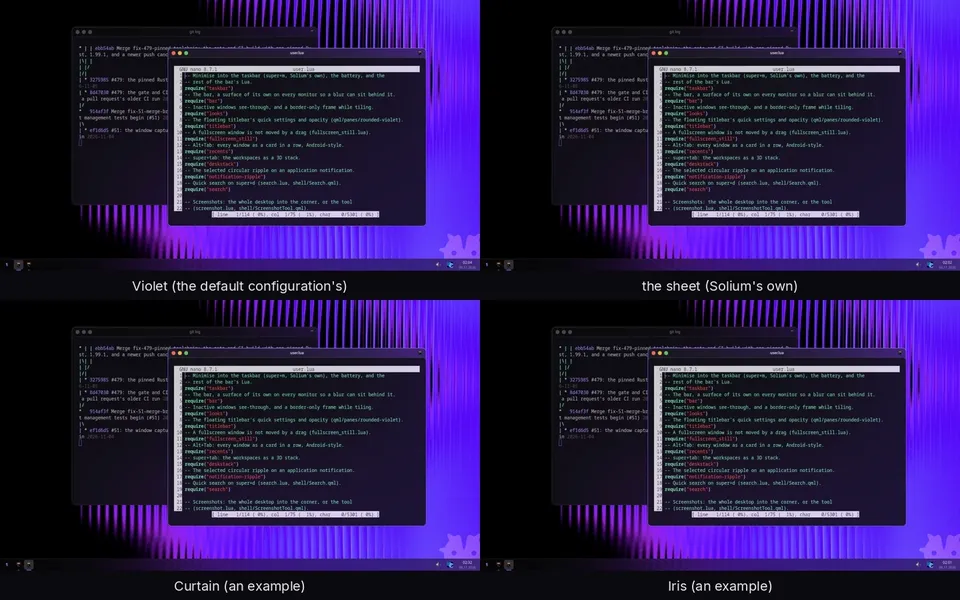

The same lock, in and out, under four scenes: each is one QML file, and lock.scene in user.lua picks it.

## Morphs

A window's way into its taskbar button is an effect folder: Lua that places a
grid of points for each moment, and, beside it if it wants one, GLSL for the
pixels. The default configuration's minimise plays the folder named `genie`,
and a folder of yours of that name takes its place.

### Four ways to minimise

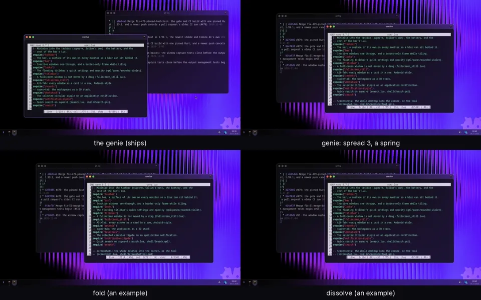

The same super+m and click under four morphs: the shipped genie, the genie with two numbers changed, and two example effect folders.

## Frames

A window's frame is a folder of QML: a `Pane.qml` saying what it reserves, and
its layers. `pane` in `user.lua` picks one; every shipped one is below.

### Fourteen frames

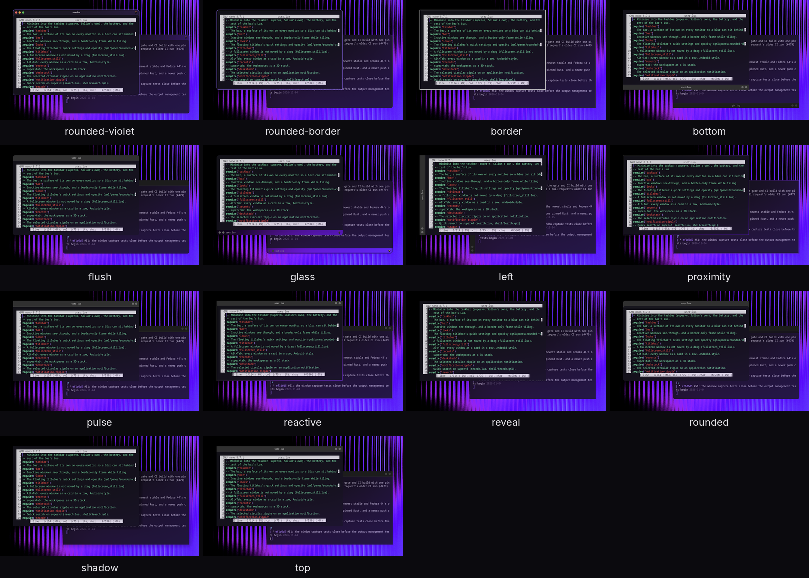

Every frame style that ships, on the same two windows: each is a folder of QML, and pane in user.lua picks one.

### Frames that move

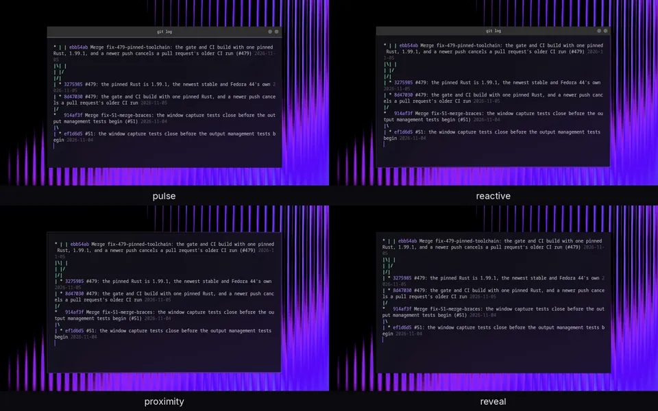

Four frame styles that animate, each a folder of QML: a running sheen, a glow that follows the pointer, a border that wakes, and a titlebar that appears.

### Liquid glass

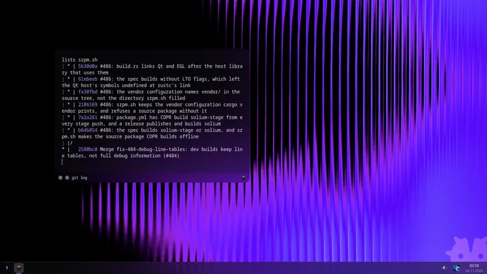

[2 times slower](media/glass-x2.mp4)

The glass frame style: the window and its bar one rounded piece of dark glass. Dragged across the wallpaper, the backdrop bends round the rim and the light runs along its edge.

**Keys:** super+drag

**How it is done.** `pane = "glass"` in user.lua. The glass is an effect folder, crates/solium/effects/glass, which the style puts behind every window it frames.

Changed for this one, in `user.lua`:

```lua
config.pane = "glass"
```

## Shaders

An effect is a folder of GLSL and Lua, in `~/.config/solium/effects/`, put on
any part of a window by a rule in `user.lua`. Its params can be animated from
Lua, a frame at a time.

### An animated shader

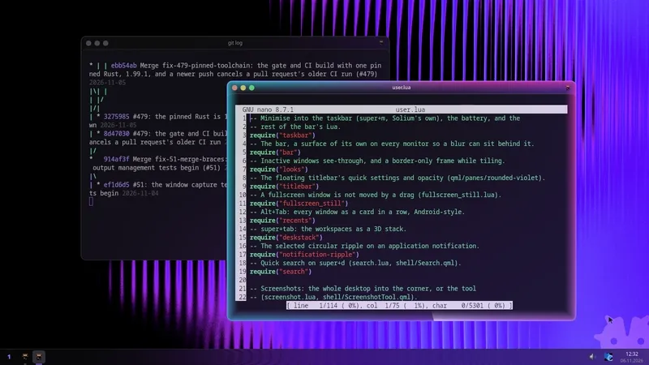

An example effect: a neon band round the focused window, its colours drifting and a white-hot head running round the edge. One GLSL file for the band, and a timer in Lua that turns its phase every frame.

**How it is done.** An effect's params can be animated by handing its rules over again with new values: Solium keeps what each slot captured and runs only the shader again.

Changed for this one, in `user.lua`:

```lua
config.effects.rules = { require("aurora").rule }
```

[`docs/showcase/examples/effects/aurora/aurora.frag`](../docs/showcase/examples/effects/aurora/aurora.frag)

```glsl
// The band, in the part's own pixels, as the shipped shade draws its edge:
// d is the signed distance to the rounded outline, so it follows the
// corners. A neon line on the outline and a glow reaching `width` in from
// it, coloured round the outline by angle (violet, cyan, magenta) and
// drifting with `phase`, and a white-hot head of light at `phase` that
// trails `tail` of the way round behind it. Premultiplied, and antialiased
// across the outline.
vec4 sol_effect(vec2 uv) {
    vec2 size = sol_content.zw * sol_box_px;
    vec2 p = sol_to_content(uv);
    float d = sol_sdf_rrect(p, size, sol_radii);
    float cover = clamp(0.5 - d, 0.0, 1.0);
    if (cover <= 0.0 || p_width <= 0.0) return vec4(0.0);
    float x = max(-d, 0.0);
    float line = 1.0 - smoothstep(2.0, 5.0, x);
    float band = pow(clamp(1.0 - x / p_width, 0.0, 1.0), 1.2);
    vec2 c = p - size * 0.5;
    float angle = atan(c.y, c.x) / 6.2831853 + 0.5;
    float hue = fract(angle - p_phase) * 3.0;
    vec3 violet = vec3(0.62, 0.35, 1.00);
    vec3 cyan = vec3(0.20, 0.95, 1.00);
    vec3 magenta = vec3(1.00, 0.25, 0.80);
    vec3 colour = hue < 1.0 ? mix(violet, cyan, smoothstep(0.0, 1.0, hue))
        : hue < 2.0 ? mix(cyan, magenta, smoothstep(0.0, 1.0, hue - 1.0))
        : mix(magenta, violet, smoothstep(0.0, 1.0, hue - 2.0));
    float trail = fract(p_phase - angle);
    float head = pow(clamp(1.0 - trail / p_tail, 0.0, 1.0), 3.0);
    colour = mix(colour, vec3(1.0), head * 0.6);
    float glow = 0.7 + 0.3 * head;
    float a = clamp(max(line, band * 0.9) * glow * p_strength, 0.0, 1.0) * cover;
    return vec4(colour * a, a);
}
```

[`docs/showcase/examples/lua/aurora.lua`](../docs/showcase/examples/lua/aurora.lua)

```lua
aurora.rule = {
    match = { focused = true, fullscreen = false },
    part = "pane",
    slot = "front",
    effect = { "aurora", phase = 0 },
}

local elapsed, ticking = 0, false

local function tick()
    elapsed = elapsed + 16
    aurora.rule.effect.phase = (elapsed % PERIOD) / PERIOD
    local looks = package.loaded.looks
    if looks and looks.refresh then
        looks.refresh()
    end
end

-- Once the desktop is up, and again after a reload.
local function start()
    if not ticking then
        ticking = true
        sol.every(16, tick)
    end
end
sol.on("monitors", start)
sol.on("restore", start)

return aurora
```

## The pointer and the keyboard

### The pointer


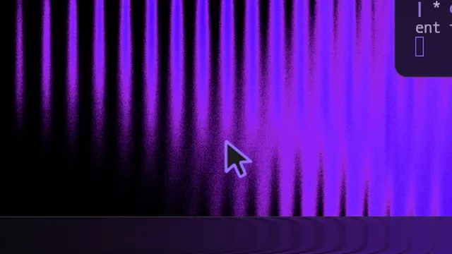

4 times slower.

The default configuration's pointer is a QML scene: every shape is one outline of the same points, so a change of shape is a morph around the hotspot. Here over a terminal's text, a link, and a window's edge.

**How it is done.** cursor = { scene = ... } in user.lua names Cursor.qml. Moving fast lights a glow, a MultiEffect, which only the GPU path draws: a nested capture, like this one, leaves it out.

Changed for this one, in `user.lua`:

```lua
config.cursor.size = 48
config.floating.atrium.enabled = false
```

[`crates/solium/default-config/cursor/Cursor.qml`](../crates/solium/default-config/cursor/Cursor.qml)

```qml
// The pointer, in the desktop's violet (cursor.scene in user.lua).
//
// A dark arrow with a violet edge; an I-beam over text; a ring with a dot for
// links; a double arrow for every resize, turned to its direction; a four-way
// arrow to move; a spinning arc beside the arrow while something is busy; a
// cross; a struck-out ring. Moving it fast lights a soft violet glow, so it
// is easy to find, and a press tucks it in a little.
//
// Every shape is one outline of the same number of points, so a change of
// shape is a morph: the outline it had flows into the next one's, point by
// point, while the colours cross over and the small details (a link's dot,
// the busy arc, the strike) grow in or fade out. The point the pointer is at
// never moves: the arrow's tip is where every other shape is centred, so a
// morph happens around the click point rather than jumping across it.
```

### The keyboard pill

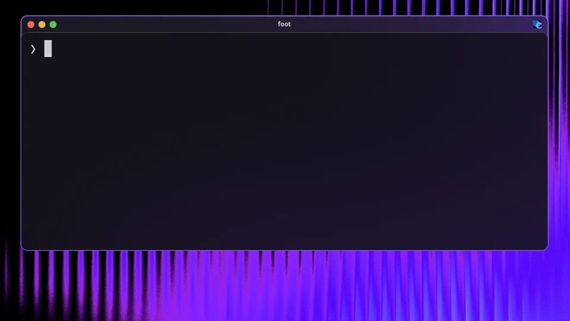

Typing in foot: Caps Lock on and the pill says so just under the caret; the layout switched to Russian and it says that; it follows the caret as the text runs on.

**Keys:** caps_lock, shift+alt_l

**How it is done.** keyboard.indicator in config.lua and lua/keyboard_indicator.lua, from the caret foot reports over text-input-v3. Every shipped frame style draws the pill with one line, KeyboardPillLayer {}.

Changed for this one, in `user.lua`:

```lua
config.keyboard = { layout = "us,ru", options = "grp:alt_shift_toggle" }
```
